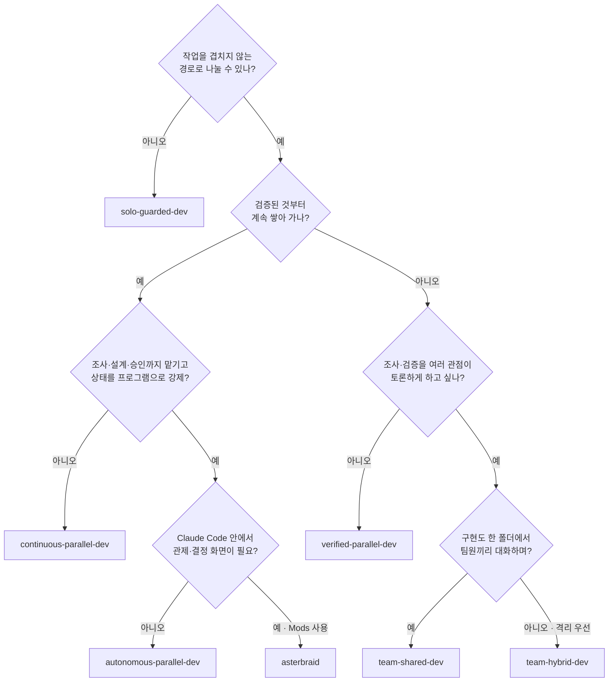

# harness-templates

Claude Code 하네스 템플릿 모음. 모든 템플릿이 같은 두 가지를 기본으로 갖는다.

- **안전장치**: `git push`·PR 생성 거부(push는 사람이 한다), `.env`·키 파일 읽기 거부.
  `git add`·`commit`과 merge·rebase·브랜치 삭제는 자동 루프를 위해 승인 없이 허용한다(autonomous 템플릿은 rebase·`reset --hard`·`branch -D`를 묻는다).
- **검증 게이트**: `verify.py` Hook이 관련 파일이 바뀌었을 때 테스트를 돌려 PASS / SKIP / FAIL / BLOCKED로 판정한다.
  FAIL·BLOCKED면 Claude가 멈추지 않고 고치거나 보고한다. 테스트 명령은 `verify.config.json`에서 정한다.

## 템플릿
| 템플릿 | 구조 | 규모 | 비용 | 안전성 | 맞는 일 |
|---|---|---|---|---|---|
| [`solo-guarded-dev`](solo-guarded-dev/) | 1인 세션 + Stop Hook | 1인 | 낮음 | 기본 | 대부분의 프로젝트, UI 비중이 큰 일 |
| [`verified-parallel-dev`](verified-parallel-dev/) | manager + worktree implementer(최대 3) + verifier | 병렬 | 중간 | 높음 | 경로가 나뉜 큰 작업, 변환기·마이그레이션 |
| [`continuous-parallel-dev`](continuous-parallel-dev/) | verified-parallel-dev + 작업 대기열 + 검증 게이트 자동 통합 | 병렬, 지속 | 높음 | 높음 | 기능을 계속 쌓아 가는 장기 개발 |
| [`autonomous-parallel-dev`](autonomous-parallel-dev/) | 결정론적 스케줄러 + 조사·설계·미리보기 승인 + 임시 worktree 통합 | 병렬, 자율 | 가장 높음 | 높음 | 작업이 많고 오래 이어지는 프로젝트, 사용자 개입을 줄이고 싶을 때 |
| [`asterbraid`](asterbraid/) (**AsterBraid**, 대표) | autonomous-parallel-dev + Claude Code Mod 관제 Pane + 구조화된 사용자 결정 + 해시로 묶은 미리보기 승인 | 병렬, 자율 | 가장 높음 | 높음 | 위와 같되 manager와 대화하며 진행을 지켜보고 결정·검토를 자주 할 때 (Mods 필요) |
| [`team-shared-dev`](team-shared-dev/) | Agent Teams, 작업 폴더 공유, 작업 Hook | 팀 3~5 | 높음 | 중간 | 파일 경계가 뚜렷한 새 기능 |
| [`team-hybrid-dev`](team-hybrid-dev/) | 조사·검증은 팀원, 구현은 worktree | 팀 + 병렬 | 가장 높음 | 가장 높음 | 조사가 먼저 필요하고 틀리면 안 되는 큰 작업 |

고르는 법: 먼저 `solo-guarded-dev`로 시작하고, 작업을 독립 경로로 나눌 수 있을 때 `verified-parallel-dev`로 올린다.
작업이 계속 이어지고 검증된 것부터 쌓아 가고 싶으면 `continuous-parallel-dev`를 쓴다(`main` 반영은 여전히 사람이 한다).
조사·설계·미리보기 승인까지 맡기고 상태·병합을 프로그램으로 강제하려면 `autonomous-parallel-dev`를 쓴다(실제 세션 검증 전).
그 진행을 Claude Code 안의 관제 화면으로 보고 결정·검토를 화면에서도 하려면 `asterbraid`(AsterBraid)를 쓴다(Mods API early access, 2.1.331에서 검증. 실제 세션에서 템플릿과 설계 문서만으로 작은 앱을 끝까지 만들어 통합하는 것을 확인했다).
팀 템플릿 두 개는 Claude Code의 **실험 기능**(Agent Teams)에 의존한다.

각 템플릿의 자세한 흐름도는 그 폴더의 README "흐름" 절에 있다.

## 공통 적용 방법
1. 고른 템플릿의 `CLAUDE.md`와 `.claude/`를 프로젝트 루트(git 저장소)에 복사한다. 기존 파일이 있으면 합친다.
2. `CLAUDE.md`의 TODO를 채우고 `.claude/hooks/verify.config.json`을 프로젝트 테스트 명령에 맞춘다.
3. `.gitignore`에 `.claude/settings.local.json`(worktree를 쓰면 `.claude/worktrees/`도)을 넣는다.
4. 한 번 수동 실행: `python .claude/hooks/verify.py --target . --force`

필요한 것: git, Hook 실행용 `uv`(없으면 Hook의 `command`를 `python`으로 바꾼다). `verify.py`는 표준 라이브러리만 쓴다(Python 3.8+).
`verify.config.json`의 키 설명과 pytest·Node·Gradle 예시는 [`verified-parallel-dev/README.md`](verified-parallel-dev/README.md)에 있다.

## 실행 방법
권한 설정과 Hook(자동 테스트)은 어떻게 열든 똑같이 적용된다. 달라지는 것은 메인 세션이 팀장(manager / lead)으로 행동하느냐다.

| 상황 | 방법 | 비고 |
|---|---|---|
| 평소 작업 | `claude` | `solo-guarded-dev`는 이것만 쓴다 |
| 작은 작업 몇 개를 나눠 맡길 때 | 지금 세션에서 `@manager 작업 A, B를 나눠서 해줘` (verified·continuous만) | manager가 서브에이전트로 떠서 implementer·verifier를 띄운다. 일하는 동안 사람과 대화하지 못하고 끝날 때 요약 하나만 돌려준다 |
| 큰 작업을 맡길 때 | 새 터미널에서 `claude --agent manager` (team-shared-dev는 `--agent lead`) | 팀장 지침과 도구 목록(띄울 수 있는 에이전트 제한 포함)이 처음부터 적용된다. 중간에 보고·질문할 수 있다 |

- 이미 연 세션을 중간에 팀장으로 바꾸는 방법은 없다. 팀장으로 쓰려면 새 세션을 연다.
- 팀 템플릿(team-shared-dev, team-hybrid-dev)은 `@` 호출로 쓸 수 없다. Agent Teams는 메인 세션만 팀을 만들 수 있다.
- 프로젝트를 늘 팀장으로 열고 싶으면 `.claude/settings.json`에 `"agent": "manager"`를 넣는다. 그러면 간단한 질문도 팀장으로 시작한다.
- 일반 `claude` 세션에서 "manager.md 절차대로 해"라고 시킬 수도 있다.
- 팀장에게는 문서·계획 파일을 쓰도록 Write·Edit가 있다. "제품 코드를 직접 고치지 않는다"는 어떻게 열든 지침이고, 도구로 강제되지는 않는다.

## 개발
모든 템플릿의 `verify.py`는 같은 파일이다. 고치면 모두 같이 고친다(테스트가 같은지 검사한다).

Hook 자체의 테스트: `python -m unittest discover -s tests` (표준 라이브러리만, git 필요).
임시 git 저장소를 만들어 PASS / SKIP / FAIL / BLOCKED, 캐시, worktree, 작업 Hook을 실제 Hook처럼 실행한다.
GitHub Actions가 push마다 Windows·Linux × Python 3.8·3.12에서 돌린다.
`asterbraid`의 Mod는 따로 `claude plugin validate`·`claude plugin test`로 검사한다(CI의 `mod` 작업, Claude Code 버전 고정).

## 한계
- 권한 규칙은 실수 방지용이다. `Bash(git push *)`는 `git -C 경로 push`를 못 막고, `Read(**/.env)`는 Bash의 `cat .env`를 못 막는다.
  강한 격리가 필요하면 샌드박스나 OS 권한을 함께 쓴다.
- merge·rebase·`reset --hard`·`branch -D`는 막지 않는다. 잘못된 병합·삭제를 막는 것은 에이전트 지침뿐이다.
  한 세션만 다시 묻게 하려면 `claude --settings '{"permissions":{"ask":["Bash(git rebase *)"]}}'`처럼 실행한다.
- 테스트 결과 캐시는 코드와 설정만 본다. 의존성을 바꿨으면 `--force`로 다시 돌린다.
- Python은 파일 크기와 수정 시각(초 단위)이 같으면 이전 `.pyc`를 재사용한다. 그래서 1초 안에 같은 크기로 고친 코드가
  옛 코드로 테스트될 수 있다. 기본 `test_env`의 `PYTHONDONTWRITEBYTECODE`·`PYTHONPYCACHEPREFIX`가 이를 막는다. 지우지 않는다.
