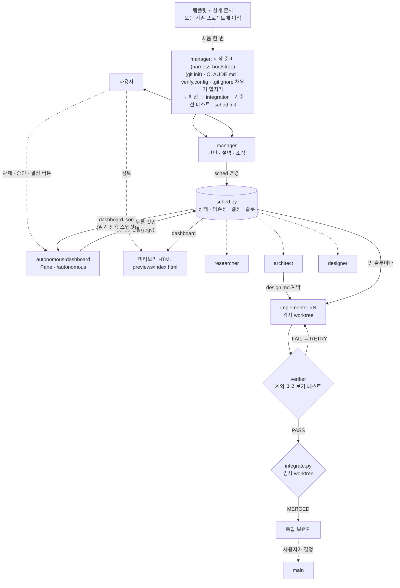

# autonomous-mods-dev

`autonomous-parallel-dev`의 자율 개발 엔진을 그대로 쓰고, Claude Code Mod(`autonomous-dashboard`)로 관제 화면을 더한 템플릿.
사용자는 **manager 한 명과 대화**하고, 나머지 에이전트의 활동과 전체 진행은 Claude Code 안의 Pane에서 본다.
구현 전 결과물은 지금처럼 브라우저의 미리보기 HTML로 검토·승인한다. 판단은 에이전트가 하고, **상태·배정·병합·승인 기록은 프로그램이 강제한다.**

## 흐름

- Pane은 스냅샷을 **읽기만** 한다. 상태를 바꾸는 것은 사용자가 Pane이나 `/autonomous`에서 직접 누르거나 입력한 승인·수정 요청·결정·슬롯·일시 중지뿐이고, 그것도 `sched.py`의 같은 검사를 거친다.
  그 밖에 Mod가 스스로 실행하는 `sched.py` 명령은 상태를 바꾸지 않는 `snapshot`(시작할 때 스냅샷만 없으면 한 번)과 `dashboard`(`/autonomous preview`)뿐이다.
- 미리보기 승인이나 결정을 기다리는 작업만 멈춘다. 독립된 작업은 조사·구현·검증·통합을 계속한다.

## 상태
`autonomous-parallel-dev`와 같다(14개 상태, 표에 없는 전이는 거부). 여기에 두 가지가 더해진다.
- **열린 사용자 결정**(`sched decide`)에 묶인 작업은 상태와 무관하게 시작·통합을 거부한다. 응답하거나 취소하면 풀린다.
- **일시 중지**(`sched pause`)는 새 배정(`start`)만 막는다. 실행 중인 에이전트·검증·통합은 계속된다.

## autonomous-parallel-dev와의 차이
| | autonomous-parallel-dev | autonomous-mods-dev |
|---|---|---|
| 스케줄러·통합·검증 엔진 | 기준 | 같은 엔진 + 아래 확장 (`verify.py`는 같은 파일) |
| 진행 상황 보기 | manager의 보고, `sched status`, HTML | + Claude Code 안의 관제 Pane(7개 탭, 버튼만으로 조작), 상태 줄 |
| 사용자 결정 | `block`·`unblock`과 대화 | 구조화된 결정 기록(선택지·장단점·추천·응답). 결정에 묶인 작업만 멈춘다 |
| 미리보기 승인 | 최신 버전 승인 | 사용자가 본 버전·해시로 승인. 파일이 바뀌었거나 새 버전이 있으면 거부 |
| 미리보기 대시보드 | Python 안의 HTML | 화면 소스를 `.claude/previewUI/`로 분리. 검색·화면 크기·버전 비교 |
| designer 스킬 | `frontend-design` 미리 불러옴(필수) | `preview-workflow` 미리 불러옴. 디자인 스킬은 있으면 골라 씀(선택) |
| 에이전트 ↔ 작업 연결 | 없음 | `start`가 준 marker로 연결, 없으면 "미연결" |
| 이상 감지 | 없음 | 긴 단계(스케줄러), 멈춤·연속 실패·유령 슬롯(Mod). 경고만 하고 판단은 manager |
| 처음 설정 | 사람이 TODO·테스트 설정·`.gitignore`·통합 브랜치를 준비 | 템플릿 + 설계 문서만 넣으면 manager가 준비하고 확인받는다 |
| 설계 | deep 프로파일(위험도 high)에서만 architect | `--needs-design [light\|standard\|deep]`로 위험도와 따로 정한다. architect는 `architecture-design` 스킬의 깊이별 형식으로 계약(인터페이스·데이터·오류)과 작업 분할을 쓴다 |
| 조사·설계만 하는 작업 | 없음 | `sched done ID --close --notes …`로 구현 없이 완료 |
| 정리 | `sched cleanup` | + `--dry-run`으로 지울 worktree·브랜치 목록을 먼저 보인다 |
| 의존 바꾸기 | 없음(취소·재등록) | `sched deps ID --set A,B`(구현 시작 전, 순환 검사). 승인된 미리보기가 있는 작업은 `cancel --force` 없이 취소되지 않는다 |
| 기존 프로젝트 | 직접 준비 | 이식하면 시작 준비가 기존 파일을 살려 합치고, 기준선 테스트를 먼저 확인한다 |
| 필요한 것 | Claude Code | Claude Code 2.1.331에서 검증(Mods API는 early access) |

고르는 법: Mods를 쓸 수 없거나 화면 없이 안정적인 엔진만 필요하면 `autonomous-parallel-dev`. 사용자가 대화하며 진행을 지켜보고 결정·검토를 자주 해야 하면 이 템플릿.

## 구성
```
CLAUDE.md                                   규칙 (TODO 채우기)
.claude/settings.json                       권한, Hook, Mod 켜기(enabledPlugins)
.claude/hooks/sched.py                      스케줄러 (+ 스냅샷·결정·일시 중지·우선순위·경고)
.claude/hooks/integrate.py                  통합 엔진 (+ 결정 대기 거부, 통합 뒤 스냅샷)
.claude/hooks/verify.py                     테스트 검증 (모든 템플릿과 같은 파일)
.claude/hooks/auto.config.json, verify.config.json
.claude/agents/                             manager, researcher, architect, designer, implementer, verifier
.claude/skills/autonomous-dashboard/        관제 Mod (Claude Code 플러그인, 자동 로드)
.claude/skills/preview-workflow/            미리보기 제작·등록·검토 절차 스킬
.claude/skills/architecture-design/         설계 깊이별 design.md 형식·규칙 (deep 점검표는 references/)
.claude/skills/harness-bootstrap/           시작 준비 절차와 verify.config.json 키 설명 (manager가 처음 한 번 부른다)
.claude/previewUI/preview.html              미리보기 대시보드 화면 소스
```
AI 도구의 소스·설정은 모두 `.claude/`에, 실행 중에 생기는 상태·결과물은 `.git/claude-auto/`에 둔다(저장소 밖이라 커밋되지 않는다).
```
.git/claude-auto/  state.json  dashboard.json(스냅샷)  integration-log.jsonl  notes/<ID>/  previews/index.html  previews/<ID>/vN.html
```
Mod를 `.claude/mods/`가 아니라 `.claude/skills/`에 두는 것은 Claude Code가 프로젝트에서 자동으로 읽는 플러그인 위치가 `.claude/skills/<이름>/`뿐이어서다(`.claude/plugins/`도 읽지 않는다).

## 사용법
1. `CLAUDE.md`와 `.claude/`를 프로젝트 폴더에 복사하고, 설계·요구사항 문서를 넣는다(예: `docs/design.md`). git 저장소가 아니어도 된다(manager가 `git init`한다).
2. **저장소 루트에서** `claude --agent manager`로 연다. 처음이면 작업 폴더 신뢰를 승인한다. Mod는 `--plugin-dir` 없이 로드된다
   (`/plugin` Installed 탭에 `autonomous-dashboard@skills-dir`. 넓은 터미널이면 Pane이 자동으로 열린다).
3. 설계 문서를 주고 진행을 맡긴다. 처음 한 번 manager가 **시작 준비**를 한다:
   문서를 보고 `CLAUDE.md`의 TODO·`verify.config.json`(테스트 명령 등)·`.gitignore`를 채울 내용을 요약해 확인받고,
   적용하고 `integration` 브랜치로 바꾼 뒤 커밋하고(`main`에는 커밋하지 않는다) `sched init`한다. 설계 결정은 그다음 `sched decide`로 연다. `verify.config.json` 수정은 승인 창이 한 번 뜬다.

그 뒤 진행은 Pane에서 보고, 결정·검토가 필요하면 manager가 묻는다. 끝나면 `integration`을 확인하고 `main`에 직접 반영한다.
직접 채우고 싶으면 시작 전에 TODO·`verify.config.json`·`.gitignore`를 채우고 `git switch -c integration`해 두면 manager가 준비를 건너뛴다.

### 진행 중인 프로젝트에 이식
1. 템플릿의 `.claude/`를 복사한다. 이미 `.claude/settings.json`·`CLAUDE.md`·`.gitignore`가 있으면 **덮어쓰지 말고** 템플릿 쪽을
   `*.harness` 같은 이름으로 옆에 둔다(시작 준비에서 manager가 둘을 합친 안을 보여 확인받는다). `.claude/agents/` 이름이 겹치면 미리 정리한다.
2. 커밋하지 않은 변경은 커밋하거나 치워 둔다(시작 준비는 섞인 변경을 커밋하지 않고 묻는다).
3. 요구(추가할 기능)를 문서로 주거나 대화로 준다. 시작 준비가 코드에서 언어·테스트 도구를 읽고, `sched init` 전에 현재 코드로 전체 테스트를 한 번 돌린다.
   기존 테스트가 실패하면 통합이 모두 막히므로, 먼저 고칠지 결정을 받는다.

Mod 끄기: `.claude/settings.local.json`에 `{"enabledPlugins": {"autonomous-dashboard@skills-dir": false}}`. 개발 기능은 그대로 돈다.
한 세션만 다른 폴더의 Mod로 열려면 `claude --agent manager --plugin-dir ./.claude/skills/autonomous-dashboard`.

## 관제 화면 (autonomous-dashboard)
```
 AUTONOMOUS shop · integration 3f2a1c9                        ⠹ 실시간 · 변화 2m00s 전
 진행 ████░░░░░░░░░░ 4/12 완료 33% (작업 수 기준)
 실행 3 · 배정 4 · 검증 1 · 통합 대기 0 · 실행 미확인 1
 ▶ 사용자 차례: 미리보기 승인 1 · 결정 1  → 4 승인·결정 탭
 ⚠ implementer API-2 12m00s째 도구 호출 없음
 ─────────────────────────────────────────────────────────────────────────────────────
  1 현황   2 작업   3 에이전트   4 승인·결정 2   5 통합·지표   6 활동   7 명령       ← 1~7 키
 ── 작업 ──────────────────────────────────────────────────────────────────────────────
 ● API-2    구현     결제 API                                     implementer · 14m02s
 ? UI-1     승인대기 결제 화면                                    v2 검토 대기
 ── manager · strategy · PAY-1 ────────────────────────────────────────────────────────
 결제 API를 먼저 통합하고 화면은 승인 뒤 시작한다
```
- 머리말(위 다섯 줄)은 모든 탭 위에 있다. 오른쪽 위 회전 표시는 Mod가 스냅샷 파일을 확인할 때마다(기본 2초) 한 칸 돈다.
  숫자가 그대로여도 표시가 돌면 자동 갱신은 살아 있고, 스케줄러 상태가 바뀌지 않은 것이다. "변화"는 스냅샷이 마지막으로 바뀐 때다.
- 레이아웃: 프롬프트 위 inline이면 **mini**(두 줄 요약), 도킹 폭 100칸 이상이면 **wide**(표 옆에 에이전트 열), 아니면 **compact**. 한글은 2칸으로 재서 자른다.
- 상태는 색과 함께 기호(✓ ● ◎ ? ✗ ↻ ⇢ ⏸ ⚠)와 글자로 보인다. 완료율은 작업 수 기준이며 공수 진행률이 아니다.
- "실행"은 이 세션에서 본 실제 서브에이전트, "배정"은 sched.py의 슬롯 점유다. 둘이 다르면 "실행 미확인"으로 표시한다.
- 스냅샷을 못 읽으면 이전 화면을 두고 "갱신 실패"와 사유를 보인다. 읽기 실패를 작업 실패·완료로 바꾸지 않는다.
- 상태 줄: `자율 완료 4/12 · 실행 3/배정 4 · 답 필요 2 · 경고 1`.

| 탭 | 내용 |
|---|---|
| 현황 | 작업 표(상태·단계·담당 에이전트와 경과 또는 기다리는 이유), manager 설명, 병목, 최근 변화 |
| 작업 | 목록(상태·우선순위·위험도·재시도, 기다리는 이유, 의존 작업, 필터, 누르면 담당 경로·완료 기준) / 타임라인(기록된 시작·끝 시각으로 그린 레인) |
| 에이전트 | 관측한 에이전트(역할, 작업·풀·시도, 시간, 도구 수, 오류, 토큰, 마지막 도구), 실행 미확인 작업 |
| 승인·결정 | 검토 대기 미리보기(열기·승인·수정 요청 입력), 열린 결정(선택지·장단점·추천·선택 버튼). 기다리는 수가 탭 이름 옆에 붙는다 |
| 통합·지표 | 통합 브랜치 HEAD, 작업 브랜치와 검증 수, 통합 대기열, 최근 통합 결과, 스케줄러 지표와 Mod 관측(동시 실행, 토큰, 세션 비용 추정) |
| 활동 | 상태 변화, 통합 결과, 결정, 에이전트 시작·끝, 도구 거부, 경고. 오류·경고만 보기 |
| 명령 | 명령을 치지 않고 버튼으로: 새로고침, 브라우저 대시보드, 배치 바꾸기, Pane 닫기, 새 배정 일시 중지·재개, 풀별 동시 실행 한도 −/+, 작업 우선순위 ▲/▼. 아래에 같은 일을 하는 `/autonomous` 명령을 보인다 |

## 명령 (`/autonomous`)
모델을 부르지 않고 바로 실행된다(manager가 응답하는 중에도).
| 명령 | 동작 |
|---|---|
| `/autonomous`, `open` / `close` | Pane 열기 / 닫기(개발은 계속) |
| `status` `tasks` `agents` `decisions` `git` `activity` `commands` | 해당 탭(`queue`·`timeline`은 작업 탭, `metrics`는 통합·지표, `errors`는 활동) |
| `preview` / `preview ID` / `preview ID v2` | 대시보드를 새로 만들어 기본 브라우저로 / 작업의 최신 / 특정 버전 열기 |
| `refresh` | 스냅샷을 다시 만들고 읽는다 |
| `layout auto\|mini\|compact\|wide` | 레이아웃 |
| `approve ID v2` / `revise ID v2 피드백` | 본 버전 승인(해시 함께) / 수정 요청 |
| `decide D-1 A [메모]` | 결정 기록 |
| `pause [사유]` / `resume`, `limit POOL N`, `priority ID N` | 새 배정 멈춤·재개, 슬롯, 우선순위 |
| `unblock ID` | 보류 해제(sched.py가 재작업·준비 상태로 되돌린다). 작업 탭에서 보류된 작업을 펼쳐 버튼으로도 한다 |

브라우저는 Windows `explorer.exe`(PATH에 없으면 `C:\Windows\explorer.exe`), macOS `open`, Linux `xdg-open`으로 연다(셸 없이). 열 수 없으면 사유와 전체 파일 경로를 알려 준다.

## 사용자 결정
manager가 중요한 선택을 만나면 결정을 열고(`sched decide add`, 선택지·장단점·추천·이유·영향 작업), `AskUserQuestion`으로 묻는다.
사용자는 대화로 답하거나 Pane에서 선택지를 누른다. 실제 응답만 기록되고(`--by user|tui`), 이미 응답한 결정은 바꿀 수 없다(새 결정을 연다).
대시보드 HTML에도 열린 결정과 응답이 보인다.

## 미리보기 승인
- designer가 `preview-workflow` 절차로 한 파일 HTML을 만들고 `sched preview`로 등록한다. 버전마다 `previews/<ID>/vN.html`과 SHA-256이 남는다.
- 승인은 본 버전과 해시로 한다: `sched approve ID --version 2 --sha <앞 12자>`. Pane·`/autonomous`는 자동으로 붙인다.
  최신 버전만 승인할 수 있다(옛 안이 필요하면 designer가 새 버전으로 다시 등록한다). 해시가 다르거나 파일이 등록 뒤 바뀌었으면 거부한다.
  수정 요청도 최신 버전에만 한다(오래된 화면 방지). `--version`을 빼면 최신 버전으로 보고, 파일 해시 검사는 언제나 한다.
- 미리보기 파일은 `.html`/`.htm`만 등록·열기한다(OS 기본 프로그램으로 다른 형식을 실행하지 않게).
- 승인한 버전의 해시가 검증 기준에 들어간다. 승인이 바뀌면 이전 검증 증거는 무효다. 승인 기록에는 시각·누가·당시 완료 기준 해시도 남는다(기록용).
- 대시보드는 읽기 전용이다. 승인 버튼이 없고 로컬 서버도 없다. 미리보기는 `sandbox="allow-scripts"` iframe으로만 띄워, 미리보기 안의 코드가 대시보드나 승인에 닿지 못한다.

## AI 문서 (`docs/ai-harness/`)
에이전트가 개발하며 남기는 문서는 저장소의 `docs/ai-harness/`에 두고 커밋한다. 세션이 바뀌어도 남고, implementer는 `sched sync`로 자기 worktree에서 읽는다.
| 폴더 | 쓰는 쪽 | 내용 |
|---|---|---|
| `requirements/` | manager | 요구 분석: 출처, 적힌 것 → 작업, 추론과 근거, 미정 → 결정. 문서로 받은 요구는 원본을 가리키고(원본이 기준), 대화로 정한 요구는 이 문서가 원본이라 보여 주고 확인받는다 |
| `research/` | researcher | 조사·진단 결과 |
| `design/` | architect | 설계·계약. implementer가 따르고 verifier가 검사한다 |
| `reports/` | manager | 끝 보고(결과, 결정, 남은 위험, 사용자가 할 일) |

파일 이름은 `YYYY-MM-DD-HHMM-<작업 ID 또는 주제>.md`, 첫머리에 작성 시각·작성자·출처·관련 작업과 결정. 서브에이전트는 쓰기만 하고 manager가 바로 `docs(ai-harness): …`로 커밋한다.
문서만 바뀌면 테스트를 돌리지 않는다(`verify.config.json`의 `ignored_prefixes`의 `docs/`). 미리보기 HTML과 상태·결정·검증 기록은 지금처럼 `.git/claude-auto/`와 `sched`에 둔다(해시로 승인하고 프로그램이 검사한다).
요구를 대화로 줄 때는 "지금 얘기한 걸 requirements로 정리해서 보여 주고, 확인받은 다음에 진행해줘"라고 하면 된다.

## 설계 깊이
manager가 작업마다 정한다. 위험도(검증 수)와 별개다.
| 깊이 | 쓰는 곳 | design.md에 반드시 |
|---|---|---|
| light | 범위가 분명한 작은 변경 | 바꿀 파일·인터페이스, 영향 범위, 경계·오류 조건, 테스트 방법 |
| standard | 일반 기능, 여러 모듈 연동, 여러 작업이 쓰는 계약 | + 대안 비교, 모듈 책임·의존 방향, 공개 인터페이스 계약(입력·출력·오류), 데이터 모델, 작업별 담당 경로 |
| deep | 핵심 구조, 복잡한 알고리즘, 데이터 무결성·보안 (deep 프로파일은 자동) | + 상태 전이, 동시성, 장애·복구, 보안, 비기능 목표, 마이그레이션 (`references/deep-checklist.md`) |

implementer는 설계 계약을 조용히 바꾸지 않고 manager에게 보고하고, verifier는 계약을 지켰는지 검토한다.
verifier는 한 번 검증할 때 막는 결함을 모두 적는다(라운드마다 하나씩 찾아 재시도 한도를 다 쓰지 않게).

## 선택 스킬
있으면 쓰고 없으면 같은 원칙으로 한다. 설치는 사용자가 한다. 스킬이 시키는 별도 worktree·서브에이전트·병합은 하지 않는다(스케줄러와 겹친다).
| 스킬 | 쓰는 에이전트 | 쓰는 곳 |
|---|---|---|
| test-driven-development, systematic-debugging, verification-before-completion (superpowers) | implementer | 새 동작, 원인을 모르는 실패, 완료 보고 전 |
| playwright-cli | verifier, designer | verifier: 웹 UI를 실제 브라우저로 열어 미리보기와 비교·버튼·입력·콘솔 오류 확인(없으면 "브라우저 검증 못 함"을 남기고 다른 근거로 판정). designer: 미리보기가 브라우저에서 뜨는지 확인 |

## 디자인 스킬 (선택)
designer는 세션에 있는 것만 `Skill`로 골라 쓴다. 없으면 기본 절차로 만든다. 설치는 사용자가 한다.
| 스킬 | 쓰는 곳 | 출처·라이선스 |
|---|---|---|
| frontend-design | 화면 프로토타입 | anthropics/claude-plugins-official (Apache-2.0) |
| ui-ux-pro-max | 디자인 시스템·토큰·접근성 | nextlevelbuilder/ui-ux-pro-max-skill (MIT) |
| visual-explainer | 구조도·흐름도·ERD·대안 비교 | nicobailon/visual-explainer (MIT) |
| impeccable | 디자인 품질 검토(verifier도 사용 가능) | pbakaus/impeccable (Apache-2.0) |
스킬이 권하는 외부 CDN·폰트·설치는 `preview-workflow` 규칙에 따라 쓰지 않는다.

## 설정
스케줄러 설정(`auto.config.json`: 슬롯, 프로파일, 재시도, 보호 브랜치)은 `autonomous-parallel-dev` README의 "설정"과 같다.
Mod 설정은 Claude Code 설정 메뉴(또는 settings의 `pluginConfigs`)에서 바꾼다.
| 키 | 기본 | 의미 |
|---|---|---|
| `openOnStart` | true | 시작할 때 Pane을 연다(좁으면 넓어질 때까지 기다린다) |
| `layout` | auto | auto / mini / compact / wide |
| `paneColumns` | 90 | 도킹할 때 요청할 폭 |
| `refreshSeconds` | 2 | 스냅샷 파일 변경 확인 간격(바뀌었을 때만 읽는다) |
| `allowActions` | true | 끄면 읽기 전용 |
| `toolDetail` | names | names: 도구·파일 이름만 / masked: 명령 앞부분을 마스킹해 보인다 |
| `launcher` | uv | sched.py 실행 방법(uv / python / python3 / py) |
| `maxEvents` | 300 | 메모리에 남길 관측 이벤트 수 |
| `statusLine`, `notify` | true | 상태 줄, 토스트 |
| `stallMinutes` | 10 | 이 시간 동안 도구 호출이 없으면 멈춤 경고 |
| `tellManager` | false | 켜면 새 경고를 manager가 읽는 메모로 한 번 덧붙인다 |
화면 선택(탭·필터·레이아웃)은 세션 상태라 리로드에도 남고 새 세션에서는 기본값이다.

## 보안
- Mod는 관찰 Hook(`agent.spawn`, `agent.report`, `tool.call`)에서 `next(e)`의 결과를 그대로 돌려준다. 권한 판정·도구 입력·프롬프트를 바꾸지 않는다.
- 프로세스는 `git rev-parse`, 프로젝트 안 `.claude/hooks/sched.py`(실제 경로가 저장소 안인지 확인), 브라우저 열기만 argv로 실행한다. 사용자 입력은 인수 하나로만 들어간다.
- 상태 변경은 사용자가 누르거나 입력했을 때만 한다. 그리기·이벤트만으로 승인·취소·복구·병합을 실행하지 않는다. `recover`·`cleanup`·통합은 Mod에 없다.
- 미리보기는 `previews/` 안의 등록된 파일만 연다. 도구 요약과 로그는 비밀값 패턴을 마스킹한다. 외부로 보내는 것은 없다. 모델을 부르지 않는다.
- 권한 규칙은 명령 문자열 비교라 샌드박스가 아니다. Mod는 Bash 권한과 별개로 실행되므로, Mod 소스(`.claude/skills/`) 수정은 승인 필요로 두었다.
- 직접 하는 `git merge`·`git worktree remove`는 묻지 않는다. 에이전트가 지침을 어기고 통합 브랜치에서 직접 `git merge`하면 검증 게이트를 거치지 않은 병합이 들어갈 수 있다.
  막는 것은 manager·implementer 지침(병합은 `integrate.py`, 충돌은 `sched sync`)이다. 한 세션만 다시 묻게 하려면
  `claude --agent manager --settings '{"permissions":{"ask":["Bash(git merge *)"]}}'`.

## 성능
- 상태를 쓸 때 같은 잠금 안에서 스냅샷을 한 번 쓴다(git 호출 1회 추가). Mod는 파일 시각만 보고 바뀌었을 때만 읽으므로 스케줄러 잠금을 잡지 않는다.
- 도구 호출 관측은 메모리에 모았다가 갱신 주기마다 한 번 쓴다. 그리기는 상태만 읽고 파일·프로세스를 건드리지 않는다.

## 복구와 여러 세션
- Mod가 다시 시작되면 스냅샷을 읽어 화면을 복원한다. 세션 이벤트가 없어졌다고 작업 상태를 바꾸지 않는다.
- 에이전트 관측은 세션별이다. 다른 세션이 실행 중인 작업은 "실행 미확인"으로 보인다. 복구는 manager가 `sched recover`로 판단한다.
- linked worktree에서 열어도 공통 git 폴더의 같은 상태를 본다.

## 테스트
- 스케줄러: `python -m unittest discover -s tests -p "test_autonomous_mods.py"` (기존 autonomous 테스트를 이 템플릿에 다시 돌리는 회귀 + 확장 기능)
- Mod: `claude plugin validate .claude/skills/autonomous-dashboard`, `claude plugin test .claude/skills/autonomous-dashboard`
- 타입: Mod 폴더를 한 번 로드하면 엔진이 `.claude-plugin/types/`를 쓰고, 그 뒤 `npx -p typescript tsc -p .claude/skills/autonomous-dashboard`

## 한계
- **실제 Claude Code 세션에서 끝까지 돌려 본 적이 없다.** 스케줄러는 실제 git 저장소 테스트, Mod는 엔진 테스트 도구(`claude plugin test`)와 타입 검사로만 확인했다.
  Pane 배치, `/plugin`의 활성 표시, 자동 열기, 브라우저 열기, manager가 marker를 지침대로 넣는지는 미확인이다.
- Mods API는 early access다. 이 Mod는 Claude Code 2.1.331 기준이며, 버전이 바뀌면 `claude plugin validate`부터 다시 본다.
- 에이전트 ↔ 작업 연결은 manager가 지시문 첫 줄에 marker를 넣어야 된다(지침). 없으면 "미연결"로만 보인다.
- 에이전트별 비용은 알 수 없다. 토큰은 Claude Code가 보고하는 값(최근 요청 입력 + 출력), 세션 비용은 추정이다.
- 사용자가 실제로 답했는지는 manager가 기록할 때 지침에 의존한다(`--by user`). Pane에서 누른 것은 `--by tui`로 남는다.
  `sched.py` 실행은 권한 규칙에서 허용돼 있어, 지침을 어긴 에이전트가 `approve`·`decide answer`를 직접 실행하는 것은 프로그램이 막지 못한다.
- 경고는 숫자 기준이라 원인을 알려 주지 않는다. 긴 단계 경고는 같은 상태의 과거 기록이 3개 이상일 때만 뜬다.
- 프로젝트 `.claude/skills/`의 플러그인은 작업 폴더 신뢰 뒤, 저장소 루트에서 열 때만 로드된다. 조직 정책이 막을 수 있다.
- 나머지 한계(병렬 실행은 manager의 지침, 권한 규칙은 샌드박스가 아님, 통합마다 전체 테스트)는 `autonomous-parallel-dev`와 같다.

## 맞는 곳과 안 맞는 곳
- 맞는 곳: 작업이 많고 오래 이어지며, 사용자가 진행을 지켜보면서 UI·설계 결정을 자주 해야 하는 프로젝트.
- 안 맞는 곳: Mods를 쓸 수 없는 환경(→ `autonomous-parallel-dev`), 작은 작업 몇 개(→ `solo-guarded-dev`), 테스트가 없거나 느린 프로젝트.
