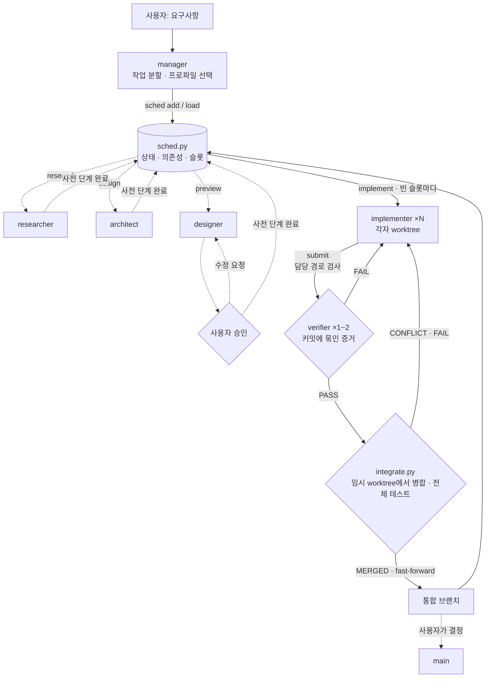

# autonomous-parallel-dev

조사·설계·미리보기·구현·검증·통합을 병렬로 계속 돌리는 자율 개발 템플릿.
판단은 에이전트가 하고, **상태·배정 규칙·병합·복구는 프로그램이 강제한다.** 사용자는 중요한 결정과 `main` 반영만 한다.

## 흐름

실선은 모든 작업이 거치는 흐름, 점선은 프로파일이나 `--preview`에 따라 거치는 단계다.
승인을 기다리는 작업만 멈추고, 다른 작업은 계속 진행한다.

## 상태
```mermaid
stateDiagram-v2
    [*] --> PENDING: 사전 단계 필요
    [*] --> READY: 사전 단계 없음
    PENDING --> RESEARCHING --> PENDING
    PENDING --> DESIGNING --> PENDING
    PENDING --> PREVIEWING --> AWAITING_APPROVAL
    AWAITING_APPROVAL --> PENDING: 수정 요청
    AWAITING_APPROVAL --> READY: 승인
    PENDING --> READY: 사전 단계 완료
    READY --> IMPLEMENTING --> VERIFYING --> READY_TO_MERGE --> MERGING --> COMPLETED
    VERIFYING --> RETRY: 검증 FAIL
    MERGING --> RETRY: 충돌 · 통합 테스트 실패
    RETRY --> IMPLEMENTING
    RETRY --> BLOCKED: 재시도 한도 초과
    COMPLETED --> [*]
```
어느 상태에서든 `block`·`cancel`할 수 있다. 표에 없는 전이는 프로그램이 거부한다.

## continuous-parallel-dev와의 차이
| | continuous | autonomous |
|---|---|---|
| 작업 관리 | manager가 Markdown을 직접 고침 | `sched.py`가 JSON 상태를 잠금·원자적 기록으로 관리 |
| 배정 규칙 | 지침 | 프로그램이 거부(의존성·경로 충돌·슬롯·중복 배정) |
| 담당 경로 | manager·verifier가 확인 | 제출할 때 프로그램이 검사 |
| 병렬도 | 구현 3명 고정 | 풀별 슬롯, `sched limit`로 조절 |
| 사전 단계 | 필요할 때 조사 | 프로파일별 조사·설계, 선택적 미리보기 승인 |
| 검증 | verifier 지침 | 커밋·검증 기준에 묶인 증거, 위험도별 verifier 수 |
| 병합 | 통합 브랜치에 병합 후 테스트, 실패하면 되돌림 | 임시 worktree에서 테스트 후 통과한 것만 fast-forward |
| 복구 | 대기열 파일을 읽고 이어감 | `sched recover`가 Git 상태와 대조 |
| 정리 | 수동 | `sched cleanup`이 조건 확인 후 삭제 |
| 직접 하는 merge 등 | 허용 | merge·`worktree remove`는 허용, rebase·`reset --hard`·`branch -D`는 승인 필요(프로그램을 통하면 묻지 않음) |

## 구성
```
CLAUDE.md                          규칙 (TODO 채우기)
.claude/settings.json              권한, Hook
.claude/hooks/sched.py             작업 스케줄러
.claude/hooks/integrate.py         통합 엔진
.claude/hooks/auto.config.json     슬롯·프로파일·재시도 설정
.claude/hooks/verify.py            테스트 검증 (다른 템플릿과 같은 파일)
.claude/hooks/verify.config.json   테스트 명령·경로
.claude/agents/                    manager, researcher, architect, designer, implementer, verifier
```
상태·노트·미리보기는 `.git/claude-auto/`에 둔다. 저장소 밖이라 작업 폴더를 더럽히지 않는다.

## 사용법
1. `CLAUDE.md`와 `.claude/`를 프로젝트 루트에 복사해 커밋한다. TODO와 `verify.config.json`을 채운다.
   (`verify.config.json` 키 설명은 `verified-parallel-dev/README.md`)
2. `.gitignore`에 `.claude/worktrees/`, `.claude/settings.local.json`을 넣는다.
3. 통합 브랜치를 만든다: `git switch -c integration`
4. 새 터미널에서 `claude --agent manager`로 열고 요구사항이나 설계 문서를 준다.
5. 끝나면 `integration`을 확인하고 `main`에 직접 반영한다.

## 설정 (`auto.config.json`)
| 키 | 의미 |
|---|---|
| `slots` | 풀별 동시 실행 수(research, design, preview, implement, verify). 실행 중에는 `sched limit implement 4` |
| `profiles` | 프로파일별 사전 단계(조사·설계)와 verifier 수 |
| `verifiers_by_risk` | 위험도별 최소 verifier 수. 프로파일 값과 비교해 큰 쪽을 쓴다 |
| `max_retries` | 넘으면 자동 BLOCKED |
| `protected_branches` | 통합 브랜치가 될 수 없는 브랜치 |
| `integration_lock_stale_s` | 죽은 통합 프로세스의 잠금을 치우는 시간 |

프로파일: `fast`(저위험), `standard`, `research`(조사 먼저), `deep`(조사 → 설계, verifier 2명).
기본 `adaptive`는 위험도와 `--needs-research`로 고른다. 어느 프로파일도 테스트와 독립 검증은 생략하지 않는다.

## 미리보기 승인 (`--preview`)
사용자가 눈으로 판단해야 하는 작업(화면, 사용자 흐름, 구조도, API 예시)에 붙인다.
designer가 한 파일짜리 HTML을 만들어 등록하면 버전별로 보관되고, 승인 전에는 구현을 시작할 수 없다.
```
sched dashboard                         # 미리보기와 전체 작업 현황 HTML 경로를 출력
sched approve UI-1                      # 최신 버전 승인 (--version N)
sched revise UI-1 --feedback "..."      # 수정 요청 → 다시 미리보기 대기열로
```
승인한 버전이 검증 기준에 들어가므로, 승인이 바뀌면 이전 검증 증거는 무효가 된다.

## 통합 안전장치와 복구
- 검증이 끝난 커밋 SHA만 병합한다. 그 뒤 브랜치가 바뀌었거나 검증 설정이 바뀌면 거부한다.
- 병합과 전체 테스트는 임시 worktree에서 한다. 통합 브랜치는 통과한 결과로만 fast-forward된다.
  충돌·테스트 실패·예외·강제 종료가 나도 통합 브랜치는 그대로다.
- 통합은 잠금으로 한 번에 하나만 돈다. 같은 작업을 다시 실행해도 두 번 병합하지 않는다.
- 세션이 끊겼으면 `sched recover --reset-running`. 실행 중이던 작업은 worktree를 남긴 채 다시 배정 대상이 되고,
  중단된 통합은 통합 브랜치에 들어갔는지 확인해 COMPLETED나 READY_TO_MERGE로 맞춘다.
- `sched metrics`: 상태별 소요 시간, 동시 실행 최대치, 슬롯 활용률, 검증 실패율, 충돌 수. 토큰은 알 수 없다(`/cost`).

## 테스트
저장소 루트에서 `python -m unittest discover -s tests -p "test_autonomous.py"`. 실제 git 임시 저장소로
의존성 순환, 중복 배정, 경로 충돌, 동시 기록, 미검증·변경된 커밋 거부, 충돌, 통합 테스트 실패,
보고서 손상, 통합 중 강제 종료, 동시 통합, 복구, 정리, 미리보기 승인을 확인한다.

## 한계
- **실제 Claude Code 세션에서 끝까지 돌려 본 적이 없다.** 프로그램은 테스트했지만 에이전트가 지침대로 움직이는지는 미확인이다.
- 병렬 실행은 manager가 한 번에 여러 에이전트를 띄워야 일어난다. 프로그램은 한도와 순서만 보장한다.
- 프로그램을 거치는 일만 강제된다. 작업 분할의 질, verifier 판단의 질, "직접 고치지 않는다"는 지침이다.
- 권한 규칙은 명령 문자열 비교라 샌드박스가 아니다. Bash로 우회할 수 있다.
- 직접 하는 `git merge`는 묻지 않는다. 에이전트가 지침을 어기고 통합 브랜치에서 직접 병합하면 검증 게이트를 거치지 않는다.
  한 세션만 다시 묻게 하려면 `claude --agent manager --settings '{"permissions":{"ask":["Bash(git merge *)"]}}'`.
- 승인은 CLI나 manager를 통해서만 한다. 대시보드는 읽기 전용 HTML이고 로컬 서버는 없다.
- 슬롯은 자동으로 늘거나 줄지 않는다. 지표를 보고 `sched limit`로 조절한다.
- designer는 `frontend-design` 플러그인의 스킬을 미리 불러온다. 플러그인이 없으면 설치하거나 `designer.md`의 `skills:` 두 줄을 지운다.
- 통합할 때마다 전체 테스트를 돈다. 테스트가 길면 통합이 병목이 된다.

## 맞는 곳과 안 맞는 곳
- 맞는 곳: 테스트가 빠르고 모듈 경계가 뚜렷하며, 작업이 많고 오래 이어지는 프로젝트.
- 안 맞는 곳: 작은 작업 몇 개(→ `solo-guarded-dev`, `verified-parallel-dev`), 테스트가 없거나 느린 프로젝트,
  한 파일에 변경이 몰리는 작업.
