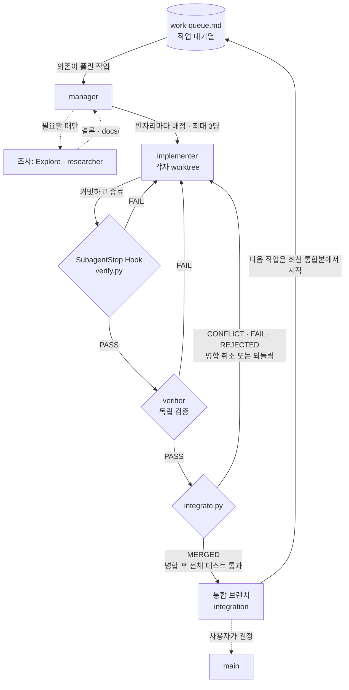

# continuous-parallel-dev

`verified-parallel-dev`에 **작업 대기열**과 **검증 게이트가 붙은 자동 통합**을 더한 템플릿.
여러 기능을 계속 병렬로 만들고, 검증을 통과한 것부터 통합 브랜치에 쌓아 가는 고처리량 개발용이다.

## 흐름


## verified-parallel-dev와의 차이
| | verified-parallel-dev | continuous-parallel-dev |
|---|---|---|
| 끝나는 지점 | 병합 후보를 사용자에게 보고 | 통합 브랜치에 자동 병합하고 다음 작업으로 |
| 작업 관리 | manager의 대화 안 | `.claude/work-queue.md` (세션이 끊겨도 이어서) |
| 병합 | 사용자가 직접 | `integrate.py`가 검증된 브랜치만, 보호 브랜치 제외 |
| 다음 작업의 기준 | 처음 HEAD | 최신 통합 결과 |
| `main` 반영 | 사용자 | 사용자 (같음) |

## 구성
```
CLAUDE.md                          규칙 (TODO 채우기)
.claude/settings.json              권한, Hook, integrate.py 허용
.claude/hooks/verify.py            테스트 검증 (다른 템플릿과 같은 파일)
.claude/hooks/verify.config.json   테스트 명령·경로
.claude/hooks/integrate.py         검증 게이트가 붙은 병합
.claude/agents/manager.md          스케줄러 겸 팀장
.claude/agents/implementer.md      worktree 구현자
.claude/agents/verifier.md         읽기 전용 검증자
.claude/agents/researcher.md       조사 담당 (선택, 결과를 docs/에 정리)
```

## 사용법
1. `CLAUDE.md`와 `.claude/`를 프로젝트 루트에 복사하고 TODO와 `verify.config.json`을 채운다.
   `verify.config.json`의 키 설명은 `verified-parallel-dev/README.md`에 있다.
2. `.gitignore`에 `.claude/worktrees/`, `.claude/settings.local.json`, `.claude/work-queue.md`를 넣는다.
3. 통합 브랜치를 만든다: `git switch -c integration`
4. `claude --agent manager`로 실행하고 할 일 목록을 준다. 작은 작업은 일반 세션에서 `@manager`로 불러도 된다(루트 README "실행 방법").
5. 끝나면 `integration`을 확인하고 `main`에 직접 반영한다(`git switch main && git merge integration`).

## integrate.py
```
uv run --no-project --offline python .claude/hooks/integrate.py <작업 브랜치>
```
| 결과 | 의미 |
|---|---|
| MERGED (0) | 병합 후 전체 테스트 통과 |
| REJECTED (2) | 작업 브랜치 worktree의 검증 보고서가 그 HEAD의 전체 테스트 PASS가 아니다 |
| CONFLICT (2) | 충돌. 병합을 취소했다 |
| FAIL (2) | 병합은 됐지만 전체 테스트 실패. 병합 전 커밋으로 되돌렸다 |
| BLOCKED (2) | 통합 브랜치가 `main`/`master`, 메인 체크아웃에 커밋 안 된 변경, linked worktree에서 실행 등 |

기록은 `.git/claude-integration-log.jsonl`에 남는다. 보호 브랜치 목록은 `integrate.py`의 `PROTECTED`에서 바꾼다.

## 주의
- 통합할 때마다 전체 테스트를 돈다. 테스트가 길면 통합이 병목이 된다. 3명으로 시작해 처리량을 보고 조절한다.
- verifier 판정은 integrate.py가 확인하지 못한다(테스트 보고서만 본다). verifier PASS 뒤에만 통합하는 것은 manager 지침이다.
- merge·rebase는 승인 없이 실행된다. 보호 브랜치에 넣지 않는 것은 `integrate.py`와 지침이 지킨다.
- 통합된 작업의 worktree는 자동으로 지우지 않는다. manager가 보고한 목록을 보고 지운다.
- `main` 반영과 push는 항상 사용자가 한다.
- 실제 Claude Code 세션에서 끝까지 돌려 본 적은 아직 없다. `integrate.py`는 `tests/test_integrate.py`로 검증했다.
