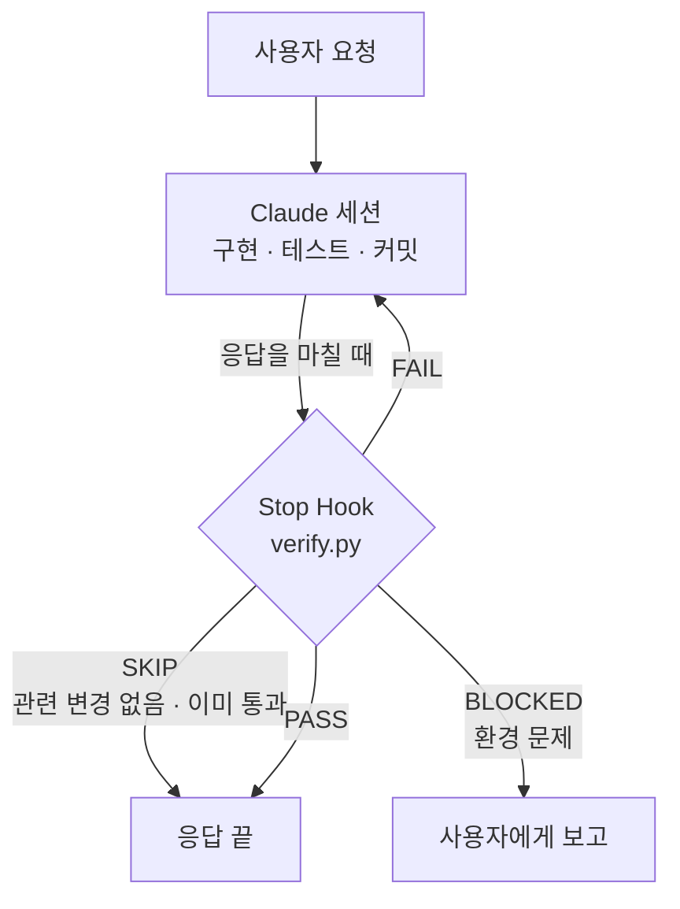

# solo-guarded-dev

1인 대화형 개발용 Claude Code 하네스 템플릿이다. 에이전트나 worktree 없이 두 가지만 한다.

- **안전장치**: push와 PR 생성은 거부한다. merge, rebase, `reset --hard`, 브랜치 삭제, remote 변경은 자동 루프를 위해 승인 없이 허용한다. 인증 파일은 읽기를 거부한다.
- **자동 테스트**: Claude가 응답을 마칠 때마다(Stop Hook) 관련 파일이 바뀌었으면 테스트를 돌린다.
  실패하면 Claude가 멈추지 않고 이어서 고친다.

여러 작업을 병렬로 맡기고 독립 검증까지 하려면 `verified-parallel-dev`를 쓴다.
두 템플릿의 `verify.py`와 `verify.config.json`은 같은 파일이다.

## 흐름

권한 설정은 이 흐름 전체에 걸린다: push·PR 생성과 `.env`·키 파일 읽기는 거부된다.

## 구성
```
CLAUDE.md                        프로젝트 규칙 템플릿 (TODO 채우기)
.claude/
  settings.json                  권한(거부/승인), Stop Hook 등록
  hooks/verify.py                검증 Hook (표준 라이브러리만 사용, Python 3.8+)
  hooks/verify.config.json       프로젝트별 테스트 명령·경로 설정
```

## 적용 방법
1. `CLAUDE.md`와 `.claude/`를 대상 프로젝트 루트(git 저장소)에 복사한다.
   대상에 이미 `CLAUDE.md`나 `.claude/settings.json`이 있으면 덮어쓰지 말고 합친다.
2. `.gitignore`에 `.claude/settings.local.json`을 추가한다.
3. `CLAUDE.md`의 `<...>`와 `TODO`를 채운다. `/init`으로 만든 초안을 참고해도 된다.
4. `.claude/hooks/verify.config.json`을 프로젝트에 맞게 고친다.
   키 설명과 pytest/Node/Gradle 예시는 `verified-parallel-dev/README.md`의 "verify.config.json" 절과 같다.
5. 수동으로 한 번 돌려 본다: `python .claude/hooks/verify.py --target . --force`

### 필요한 것
- git
- Hook 실행용 `uv`. 없으면 `settings.json` Hook의 `command`/`args`를
  `"command": "python"`, `"args": ["${CLAUDE_PROJECT_DIR}/.claude/hooks/verify.py"]`로 바꾼다.

### 주의
- 테스트가 4분 안에 끝나야 한다(`timeout_s` 240, Hook 제한 300초).
  더 오래 걸리면 `test_command`를 빠른 테스트로 좁히거나 Hook을 끈다.
- 테스트가 만드는 산출물(`.pyc`, 빌드 결과)은 `.gitignore`나 `ignored_*`에서 빼야 캐시가 듣는다.
- 기본값 `{python} -m unittest`는 `tests/`에 `__init__.py`가 있어야 테스트를 찾는다.

## 단계 전환 (조사 → 구현)
템플릿을 바꿀 필요 없다. `CLAUDE.md`의 "현재 단계"만 고친다.
조사하는 동안 코드 편집을 확실히 막고 싶으면 `settings.json`의 `deny`에 `Edit(src/**)` 같은 규칙을 넣고,
구현으로 넘어갈 때 그 줄만 지운다. 조사 문서(`docs/`)는 그대로 두고 설계 근거로 쓴다.
