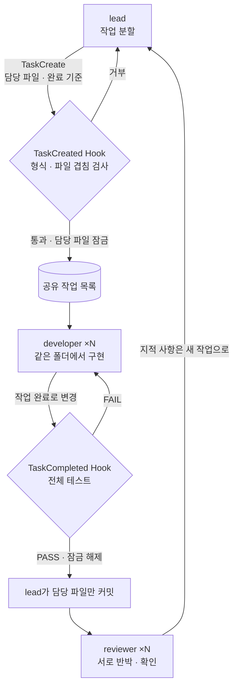

# team-shared-dev

Agent Teams로 팀원 여러 명이 **하나의 작업 폴더를 같이 쓰며** 개발하는 템플릿.
팀원끼리 메시지로 의논하고, 공유 작업 목록에서 일을 나눠 가진다.

## 흐름

팀원끼리는 메시지로 직접 의논한다. 폴더를 공유하므로 담당 파일 잠금이 서로의 작업을 지킨다.

## 구성
```
CLAUDE.md                      규칙 (TODO 채우기)
.claude/settings.json          Agent Teams 켜기, 권한, 작업 Hook
.claude/hooks/task_gate.py     작업 생성 시 형식·파일 겹침 검사, 완료 시 테스트 강제
.claude/hooks/verify.py        테스트 실행기 (다른 템플릿과 같은 파일)
.claude/hooks/verify.config.json   테스트 명령·경로
.claude/agents/lead.md, developer.md, reviewer.md
```

## 사용법
1. `CLAUDE.md`와 `.claude/`를 프로젝트 루트에 복사하고 TODO와 `verify.config.json`을 채운다.
2. 작업 브랜치를 만든다: `git switch -c feature/xxx`
3. `claude --agent lead` 로 실행하고 할 일을 말한다. Agent Teams는 메인 세션만 팀을 만들 수 있어서, 이 템플릿은 반드시 새 세션으로 연다.

## 동작
- 작업 설명에는 `담당 파일:`과 `완료 기준:` 줄이 있어야 한다. 담당 파일이 열린 작업과 겹치면 생성이 거부된다.
  잠금은 `.git/claude-task-locks.json`에 있고, 작업이 완료되면 풀린다.
- 작업을 완료로 바꾸면 `verify.py`가 전체 테스트를 돌린다. 실패하면 완료가 막힌다.
  담당 파일이 있는 작업은 실제 전체 테스트 PASS만 인정한다. "관련 변경 없음"으로 SKIP되면 테스트를 강제로 다시 돌린다.
- 커밋은 lead가 작업 단위로 한다.

## 주의
- **실험 기능**이다. 대화형 세션에서만 팀이 생긴다(`-p` 불가). `/resume`하면 팀원이 복원되지 않는다.
- 작업 목록 도구는 최신 모델에서 기본으로 꺼져 있어 `CLAUDE_CODE_ENABLE_TODO_TOOLS=1`을 settings에 넣었다.
  팀원에게 작업 도구가 안 보이면 `claude --settings '{"env":{"CLAUDE_CODE_ENABLE_TODO_TOOLS":"1"}}' --agent lead`로 실행한다.
- 폴더를 공유하므로 **한 팀원의 미완성 코드 때문에 다른 팀원의 완료가 막힐 수 있다.** 그때는 lead가 순서를 정한다.
- 잠금 검사는 거의 동시에 만든 작업끼리의 경쟁은 막지 못한다. lead가 작업을 하나씩 만들게 한다.
- 잠금이 남아 꼬이면 `.git/claude-task-locks.json`을 지운다.
- Hook 실행에 `uv`가 필요하다. 없으면 `command`를 `python`으로 바꾼다.
